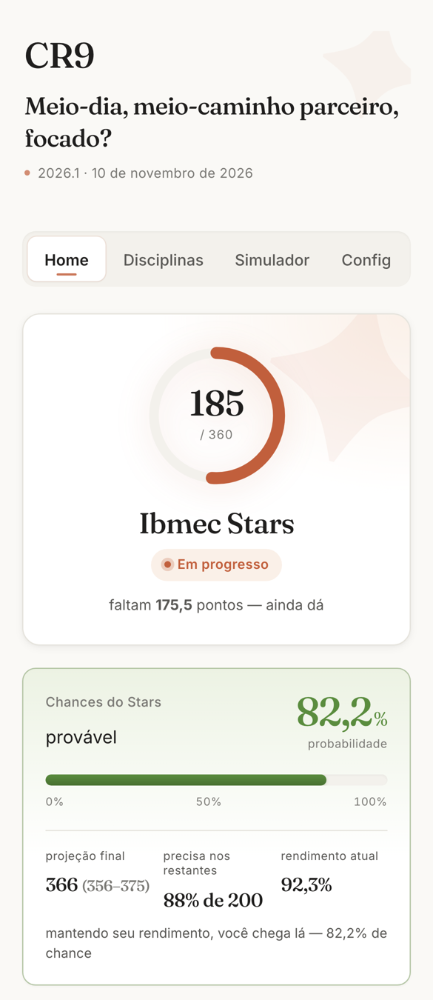
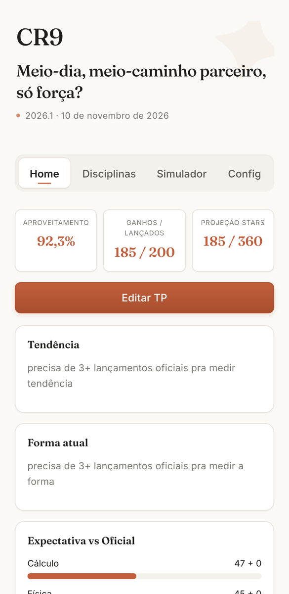

## Contexto

O Ibmec dá um reconhecimento, o Stars, a quem fecha o período com coeficiente de rendimento 9,0 ou mais em pelo menos quatro disciplinas. A conta parece simples e não é.

Cada disciplina tem duas provas, atividades de peso variável e um trabalho que soma bônus. Existe ainda uma prova substitutiva que, se feita, tira o aluno do reconhecimento. No meio do semestre, a pergunta que importa é outra: ainda dá para fechar 9?

Não achei aplicativo que tratasse essa conta direito. Fiz o meu.

## O que eu fiz

Um aplicativo web instalável no celular, sem framework, sem empacotador e sem dependência em tempo de execução. Abre sem internet.

Os dados ficam só no aparelho, no armazenamento do navegador. Não há servidor nem conta. Para trocar de celular, exporto um arquivo JSON e importo no outro.

A tela inicial tem três modos, escolhidos na primeira abertura. Um mostra a chance de fechar 9. Outro traz gráficos de acompanhamento, e o terceiro serve só para lançar nota rápido.

*Tela inicial, com disciplinas e notas fictícias.*

Chegou à versão 20 em setembro de 2026, e já guarda mais de um período, com o anterior arquivado para comparação.

## Como funciona

A chance sai de uma simulação. Para cada avaliação que ainda falta, o aplicativo sorteia uma nota de uma distribuição Beta, ajustada pelo que eu já tirei no período. Ele repete o semestre 20 mil vezes e conta em quantas a média fechou acima de 9.

A semente do sorteio vem de um hash do próprio estado. Mesmas notas, mesmo resultado. Sem isso, o número mudaria a cada vez que a tela redesenha, e ninguém confia num percentual que pisca.

Junto da chance aparece a projeção, com a média esperada e a faixa entre o décimo e o nonagésimo percentil.

Os gráficos são SVG escrito à mão. A tendência é uma regressão linear sobre as notas lançadas, e a forma recente é uma média móvel exponencial dos últimos dez lançamentos.

*Modo de acompanhamento, também com dados fictícios.*

## O que aprendi

O modelo era pessimista. Com poucas notas lançadas, ele dava peso demais ao pouco que tinha visto e a chance caía mais do que devia.

Afrouxei o ponto de partida e passei a tratar cada avaliação separadamente. A lição serve fora do aplicativo: com três notas na mão, o que eu acredito antes de ver os dados pesa mais que os próprios dados.

Aprendi também a separar nota oficial de previsão. O aplicativo deixa lançar a nota que eu espero tirar, e ela entra na projeção. Mas o selo de "garantido" só aparece com ponto oficial.

Tirei uma função no caminho. A sincronização entre aparelhos usava um banco em nuvem e foi removida em julho. O aplicativo voltou a viver num aparelho só, sem serviço nenhum por trás.

## Resultados

- 20 versões publicadas em 48 commits.
- 20 mil semestres simulados a cada cálculo, com resultado idêntico para o mesmo conjunto de notas.
- 237 KB de código no total, sem dependência externa.
- Motor matemático num arquivo separado de 17 KB, sem acesso à tela, que roda fora do navegador para teste.
