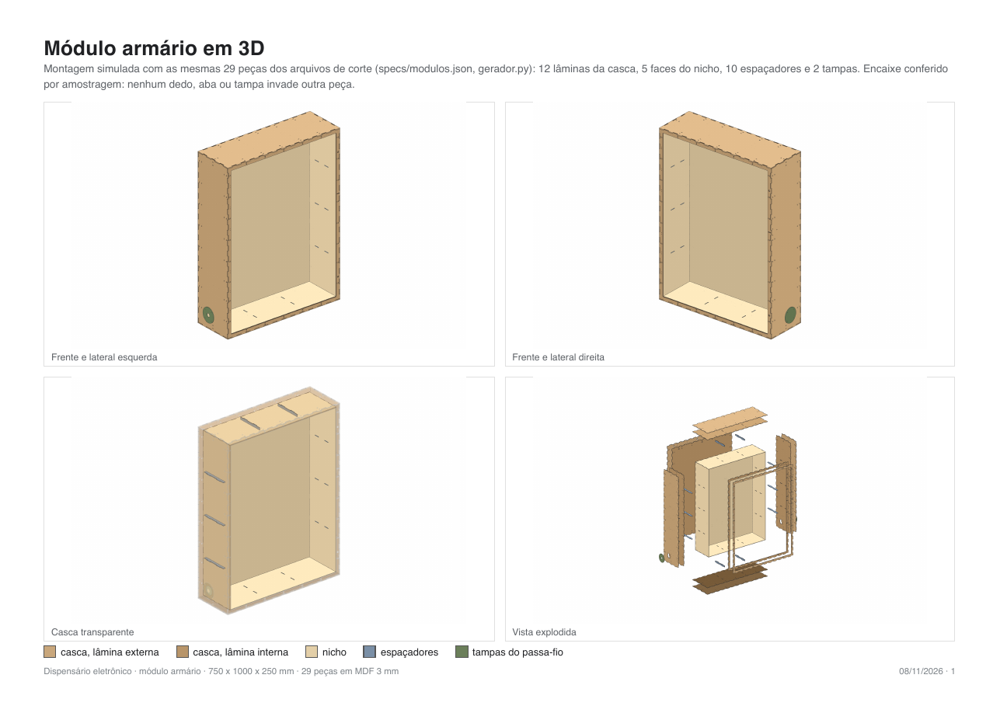
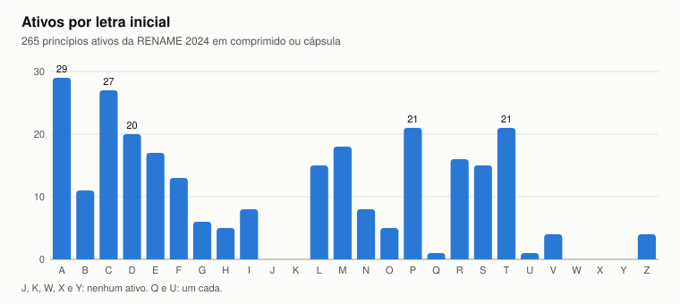
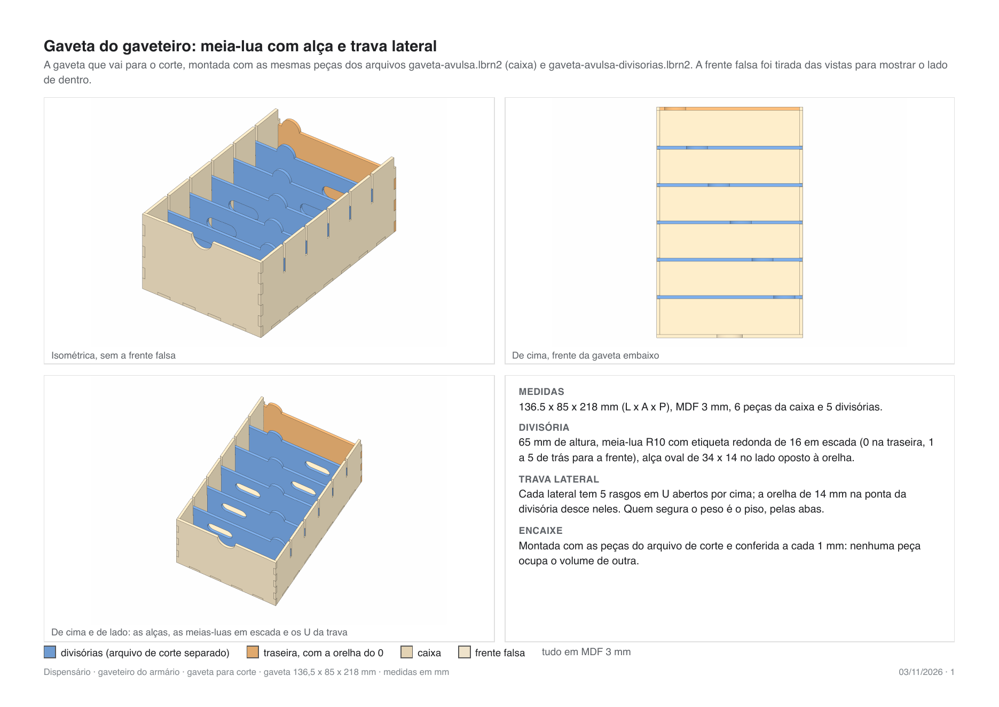
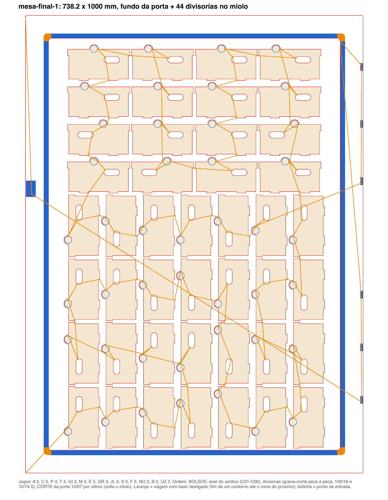

## Contexto

Em 20/08/2026 um hospital oncológico de Belo Horizonte, que atende só pelo SUS, apresentou um problema em sala. O medicamento sai de farmácias centrais: o profissional vai até o balcão, bipa o crachá, bipa o item e leva ao leito. Isso funciona, mas junta todo mundo na mesma fila.

Os equipamentos comerciais que resolvem a fila chegam perto de R$ 4 milhões. A proposta do nosso grupo de quatro alunos foi um armário pequeno, perto do paciente, que abre só para quem está autorizado e registra cada abertura. Uma unidade atende cerca de 20 leitos, com reposição duas vezes ao dia.

A entrega da disciplina é um protótipo.

## O que eu fiz

Fiquei com o gabinete, a fabricação e a documentação, e preparei a hospedagem do servidor com HTTPS. O firmware e o servidor nasceram com outro integrante do grupo.

O gabinete são dois módulos de MDF de 3 mm cortados a laser. O biométrico, de 250 x 250 x 1000 mm, leva tela, teclado, leitor de digital e câmera. Já o armário mede 750 x 1000 x 250 mm e tem porta de acrílico, fechadura elétrica e um gaveteiro.

Nenhuma coordenada foi desenhada à mão. As medidas moram num arquivo JSON, e um gerador em Python monta as faces, recorta os vãos e empacota as peças em cargas que cabem na mesa da cortadora. Corrigir uma cota é trocar um número e rodar de novo.

*As 29 peças do armário montadas em 3D a partir dos arquivos de corte.*

Também escrevi o site do projeto, em nove páginas, com requisitos, eletrônica, firmware, servidor, gabinete e fabricação.

## Como funciona

Duas placas, com papéis separados. Um Arduino Mega lê o teclado e a digital, guarda os cadastros e decide sozinho quem entra. A ESP32-CAM recebe os eventos pela serial, fotografa o acesso autorizado e entrega tudo ao servidor.

A regra que organiza o resto: o acesso nunca depende de rede. Se o Wi-Fi cair, a porta continua abrindo para quem tem direito. O servidor serve para auditoria.

No gabinete, cada parede é um sanduíche de duas lâminas. As faces se unem por abraçadeiras de nylon em vez de parafuso, e o conjunto se desmonta com um alicate. A altura de 1000 mm veio da cortadora, que tem mesa de 1150 x 1000 mm.

O gaveteiro saiu de uma contagem. A RENAME 2024, lista de medicamentos essenciais do SUS, tem 265 princípios ativos em comprimido ou cápsula. Contei por letra inicial e cheguei a 15 gavetas: letra frequente fica sozinha, as raras se juntam à vizinha.

*A contagem que definiu as gavetas.*

## O que aprendi

A primeira versão do armário media 1260 x 1500 x 350 mm e tinha três portas. Era bonita na tela. Doze painéis não cabiam na mesa da máquina.

Refiz o armário em 07/10 começando pela restrição: toda peça cabe em 1000 x 1000 mm. Hoje a primeira pergunta que faço num projeto de corte é o tamanho da mesa.

O leitor de digital me custou três tentativas. O manual mostrava um canal lateral de 1,5 mm, e desenhei um garfo para entrar nele. O corpo real tinha uma travinha que o desenho do fabricante não mostrava. Terminou colado com cola quente num vão justo de 20 x 18 mm.

A tabela de parâmetros colada na máquina também não valia. Ela pedia 26 mm/s a 65% para MDF de 3 mm, e a máquina só atravessou a chapa a 10 mm/s e 74,5%, número que saiu de matrizes de calibração cortadas na própria máquina.

Passei a testar em retalho toda feição que encosta num componente comprado. No cupom, a fechadura encaixou na primeira.

*A gaveta, conferida em 3D antes de ir para a máquina.*

*Uma mesa de corte com a rota calculada. Em laranja, o caminho com o laser desligado.*

## Resultados

- Armário de 750 x 1000 x 250 mm em 29 peças, montado em 3D a partir dos próprios arquivos de corte, sem sobreposição.
- 43 testes automáticos que regeram os arquivos e conferem as peças críticas.
- Rota de corte calculada: o deslocamento com o laser desligado na mesa das gavetas caiu de 21,5 m para 7,7 m.
- Anel de apoio do acrílico dividido em faixas: a gravação estimada caiu de 23 horas para perto de uma hora e meia.
- 13 requisitos funcionais e 14 não funcionais, com 12 critérios de aceite.
- Cadastro de até 100 pessoas na memória do Mega, com a senha guardada só como hash.
