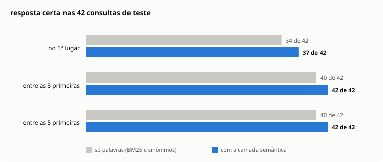

## Contexto

Um defensor público me mostrou a busca de súmulas que usava e pediu uma crítica. Ela casava texto literal. Quem escrevia "custódia cautelar" não achava "prisão preventiva", e quem escrevia "réu" recebia enunciados que só continham a palavra "reunião".

Havia duas restrições. O computador de trabalho provavelmente não deixa instalar programa, mas aceita extensão de navegador. E peça em segredo de justiça não pode passar por serviço de terceiro.

Daí a decisão que moldou tudo: a busca roda inteira na máquina dele.

## O que eu fiz

Uma extensão do Chrome que abre num painel lateral, com 4.929 súmulas e teses do STJ e do STF embutidas. Cada resultado traz a citação pronta para copiar.

*Busca por termo técnico, com os sinônimos que a consulta ganhou.*

A extensão declara três permissões: painel lateral, menu de contexto e armazenamento local. Não pede acesso a site nenhum, não injeta script em página e não faz requisição de rede.

Escrevi também um botão que junta os enunciados escolhidos num bloco com o texto integral de cada um e a fonte oficial, pronto para colar num assistente de IA. O bloco leva seis regras que proíbem citar o que não está na lista.

## Como funciona

Três sinais, fundidos numa lista só.

O primeiro é o BM25, o cálculo clássico de relevância por palavra, aplicado sobre radicais. Um redutor de palavras do português, escrito em JavaScript, serve tanto para montar o índice quanto para ler a consulta. Assim o plural e o singular da mesma palavra se encontram.

O segundo é um dicionário de 79 grupos de sinônimos, escrito à mão. Cobre o par técnico e também o leigo, como "pai não paga pensão" e "prisão civil do devedor de alimentos".

O terceiro é semântico e não usa modelo de linguagem. Uma decomposição matemática do próprio acervo resume cada enunciado em 128 números. Ocupa 2 MB dentro do pacote e liga "preso trabalhou na cadeia" a "remição da pena pelo trabalho" sem que ninguém tenha escrito essa ligação.

*Caso descrito em linguagem comum, achado pela camada semântica.*

Palavra digitada errado cai numa busca por trigramas e vira o termo conhecido mais próximo.

## O que aprendi

Não dá para ajustar uma busca no olho. Montei 42 consultas com a resposta certa declarada, entre termo técnico, número de súmula, erro de digitação e caso contado em linguagem comum. Um script roda as 42 e conta em quantas a resposta certa aparece no topo.

Com esse portão, os pesos da fusão deixaram de ser palpite. Outro script varre as combinações e imprime a melhor.

Foi ele que mostrou quanto vale a parte semântica. Só com palavras, a resposta certa vinha em primeiro lugar em 34 das 42 consultas. Com a semântica, em 37. Parece pouco. Mas as duas consultas que não apareciam nem entre as cinco primeiras passaram a aparecer entre as três.

*Antes e depois da camada semântica.*

O ponto fraco é o acervo. Ele vem de uma captura de julho de 2026, e a ingestão direta das fontes oficiais ainda não existe. Também falta a prova de uso: a extensão está empacotada, mas ainda não passou por um dia de trabalho real.

## Resultados

- 4.929 enunciados pesquisáveis sem internet.
- Resposta certa entre as três primeiras em 42 das 42 consultas de teste, e em primeiro lugar em 37.
- Três permissões declaradas e nenhuma requisição de rede.
- Pacote de instalação de 2,0 MB.
